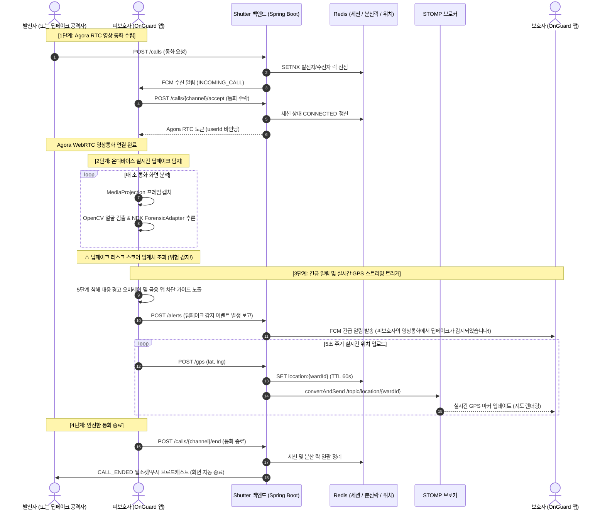
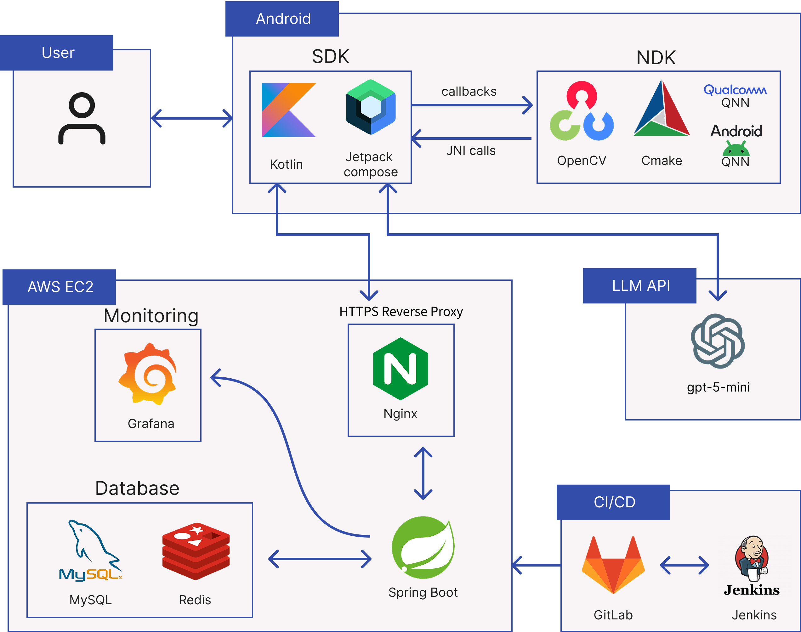
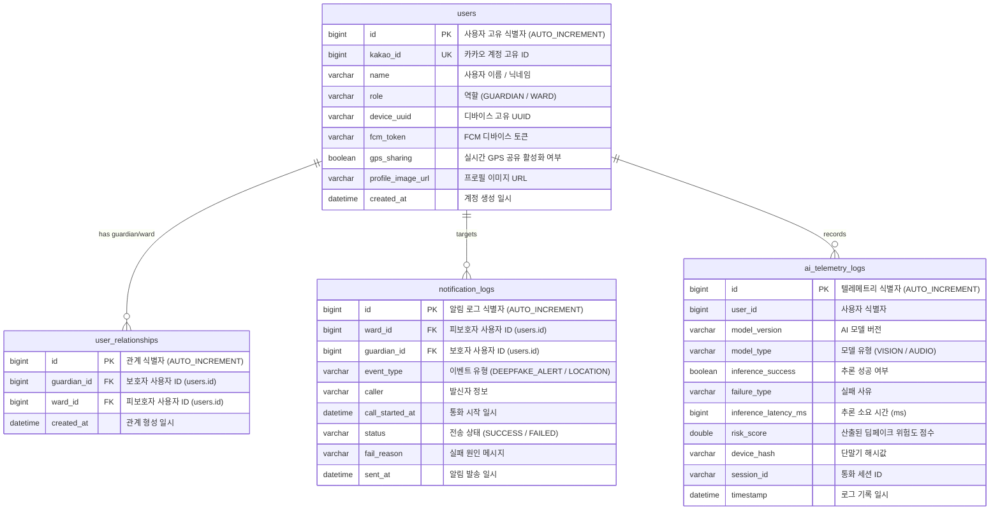

# OnGuard (온가드)

<div align="center">


### **실시간 온디바이스 AI 딥페이크 탐지 및 영상통화 기반 가족 안심 보이스피싱 방어 시스템**

[](https://www.oracle.com/java/)
[](https://spring.io/projects/spring-boot)
[](https://kotlinlang.org/)
[](https://developer.android.com/jetpack/compose)
[](https://onnxruntime.ai/)
[](https://redis.io/)
[](https://www.mysql.com/)
[](https://www.docker.com/)

</div>

---

## 목차 (Table of Contents)

1. [프로젝트 소개 (About OnGuard)](#1-프로젝트-소개-about-onguard)
2. [기획 배경 및 해결하려는 문제 (Why OnGuard?)](#2-기획-배경-및-해결하려는-문제-why-onguard)
3. [핵심 기능 및 서비스 흐름 (Core Features & Flow)](#3-핵심-기능-및-서비스-흐름-core-features--flow)
4. [시스템 아키텍처 및 인프라 (Architecture & DevOps)](#4-시스템-아키텍처-및-인프라-architecture--devops)
5. [상세 기술 스택 (Tech Stack Breakdown)](#5-상세-기술-스택-tech-stack-breakdown)
6. [시작하기 (Quick Start Guide)](#6-시작하기-quick-start-guide)
7. [데이터베이스 설계 및 ERD (Database & ERD)](#7-데이터베이스-설계-및-erd-database--erd)
8. [핵심 API 명세 (Core API Specification)](#8-핵심-api-명세-core-api-specification)

---

## 1. 프로젝트 소개 (About OnGuard)

**OnGuard**는 생성형 AI 기반의 고도화된 실시간 딥페이크(Deepfake) 영상통화 피싱 범죄로부터 **디지털 취약계층(노약자, 미성년자 등)을 보호하는 스마트 안심 방어 플랫폼**입니다.

피해자가 통화 화면을 보고도 조작 여부를 분간하기 어려운 딥페이크 공격을 **스마트폰 단말기 내부(On-Device AI)**에서 네트워크 지연 없이 실시간 감지하고, 이상 징후 포착 즉시 사전에 등록된 **보호자에게 실시간 긴급 푸시 알림 및 초저지연 GPS 위치 공유**를 트리거하여 범죄 피해를 원천 차단하는 골든타임을 확보합니다.

### 👥 팀원 소개 및 역할 (Team OnGuard)

| 이름 | 역할 | 주요 담당 업무 |
|:---:|:---:|---|
| **윤상현** | **Backend / Infra** | 카카오 OAuth2 & 무상태 JWT 인증 체계 구축, 보호자-피보호자 도메인 및 RDBMS/Redis 모델링, Agora RTC 분산 세션 제어 및 토큰 보안 바인딩, Redis 분산 락(SETNX) 기반 동시성 제어, WebSocket(STOMP) 실시간 GPS 브로드캐스팅 및 Keyspace 만료 감지, Nginx Blue/Green 무중단 배포 및 Jenkins CI/CD 파이프라인 구축 |
| **박수민** | **Frontend / Backend** | Android 전체 UI/UX 개발 (Compose), 실시간 GPS 백그라운드 추적 및 위치 동기화, 카카오톡 친구 목록 연동 및 보호자 등록·관리, 딥페이크 감지 타임라인 화면, 딥페이크 발신자 시뮬레이터(Demo) 개발, Grafana 텔레메트리 파이프라인 연동 |
| **이세원** | **Frontend** | 침해 대응 5단계 경고 오버레이 애니메이션 설계 및 구현, Agora 영상통화 탐지 UI 연동, 통화 중 금융 앱 실행 감지 및 시스템 레벨 차단 가이드 오버레이 구현 |
| **정다진** | **Frontend / AI** | Agora RTC 영상통화 라이프사이클(요청·수락·종료) 처리, NDK C++ 네이티브 추론 브릿지 구현, 온디바이스 딥페이크 탐지 파이프라인 최적화, 영상 전처리 및 프레임별 탐지 결과 슬라이딩 윈도우 집계 |
| **성주희** | **Frontend / AI** | 딥페이크 경고창 및 실시간 탐지 바운딩 박스 오버레이, OpenCV 얼굴 랜드마크 검출, NDK 기반 온디바이스 Whisper STT 음성 전사 및 GPT-4o-mini 위험 키워드 분류 연동, HTP $\to$ GPU $\to$ CPU 하드웨어 폴백 및 QNN/NNAPI 최적화, INT8 양자화 |
| **장유진** | **AI** | NDK 온디바이스 딥페이크 합성 모델 탐지 알고리즘 연구, ForensicAdapter 학습 및 성능 고도화, Grad-CAM 기반 위변조 관심영역(ROI) 추출 및 전처리 파이프라인 구축, PyTorch 모델의 ONNX 변환 및 최적화 |

### 📂 서브모듈 가이드

| 서브모듈 | 설명 | 바로가기 |
|---|---|---|
| **Android App** | Kotlin, Jetpack Compose 기반 모바일 애플리케이션 | [frontend/shutter-android/README.md](frontend/shutter-android/README.md) |
| **On-Device AI** | NDK C++, ONNX Runtime 기반 온디바이스 모델 추론 엔진 | [frontend/shutter-android/app/src/main/cpp/AI_README.md](frontend/shutter-android/app/src/main/cpp/AI_README.md) |
| **Demo Simulator** | 웹캠 실시간 페이스스왑 딥페이크 공격 시뮬레이터 | [frontend/shutter-android/demo/README.md](frontend/shutter-android/demo/README.md) |
| **Backend API** | Spring Boot 3.5, Java 21 기반 백엔드 및 인프라 | [shutter-BE/README.md](shutter-BE/README.md) |
| **Porting Manual** | 프로덕션 환경 배포 및 포팅 매뉴얼 | [exec/포팅매뉴얼.md](exec/포팅매뉴얼.md) |

---

## 2. 기획 배경 및 해결하려는 문제 (Why OnGuard?)

### 🚨 배경 및 문제 상황

1. **실시간 생성형 딥페이크 영상통화의 위협**
   * 최근 보이스피싱은 단순 음성 사칭을 넘어, AI 페이스스왑 기술을 활용해 가족이나 지인의 얼굴을 실시간 합성하는 영상통화 범죄로 진화했습니다.
   * 육안으로는 인위적 결함을 인지하기 어려우며, 특히 고령층이나 미성년자는 무방비로 사기 피해에 노출됩니다.
2. **사후 약방문식 대처의 한계와 골든타임 상실**
   * 송금이나 개인정보 유출이 완료된 후 신고하는 기존 방식으로는 피해액 회수가 거의 불가능합니다.
   * 통화가 진행되는 **수 분 내의 실시간 탐지 및 즉각적인 보호자 개입 체계**가 필수적입니다.
3. **네트워크 서버 분석의 프라이버시 및 지연 한계**
   * 실시간 통화 영상을 외부 클라우드 서버로 매 프레임 스트리밍하여 분석하는 방식은 **사용자 사생활 침해 위험**이 크고, **네트워크 지연(Latency)**으로 실시간 차단이 어렵습니다.

### 💡 OnGuard의 해결 전략 (Problem vs Solution)

| 문제점 (Pain Point) | OnGuard의 해결 전략 (Solution) |
|---|---|
| **실시간 영상 딥페이크 식별 불가** | **온디바이스 경량 AI (ForensicAdapter ONNX)**: 외부 서버 전송 없이 단말기 NPU/GPU 가속으로 1초당 프레임을 분석하여 딥페이크 확률 실시간 산출 |
| **통화 중 보호자 연락 수단 부재** | **자동 비상 알림 파이프라인**: 딥페이크 탐지 즉시 등록된 보호자에게 **카카오/FCM 긴급 푸시 알림** 발송 및 위치 추적 자동 활성화 |
| **통화 중 피보호자 위치 미인지** | **초저지연 실시간 GPS 브로드캐스팅**: Redis 인메모리(TTL 60초)와 Spring WebSocket(STOMP)을 결합하여 보호자 지도 화면에 피보호자 이동 경로 실시간 렌더링 |
| **대화 음성 맥락의 위험도 파악 불가** | **온디바이스 STT + 위험 맥락 태깅**: Whisper BASE 온디바이스 음성 전사 및 GPT-4o-mini 연동으로 `#금융거래`, `#개인정보요구` 등 사기 맥락 자동 분류 |
| **당황한 피해자의 송금 실행 방지** | **시스템 레벨 5단계 경고 오버레이**: 딥페이크 판정 시 화면 상단 경고 표시와 함께 은행/증권 앱 실행을 즉각 차단하는 안전 가이드 오버레이 작동 |

---

## 3. 핵심 기능 및 서비스 흐름 (Core Features & Flow)

### 📌 4대 핵심 기능

1. **온디바이스 AI 기반 실시간 딥페이크 탐지 파이프라인**
   * `MediaProjection`을 통해 수신 중인 영상통화 화면을 프레임 단위로 캡처
   * OpenCV 기반 고속 얼굴 영역 검출 후 INT8 양자화된 `ForensicAdapter` 모델로 추론
   * Qualcomm QNN / Android NNAPI 가속을 적용하여 NPU $\to$ GPU $\to$ CPU 하드웨어 폴백 지원
   * 최근 10프레임 이동평균(Moving Average) 리스크 스코어를 산출하여 오탐(False Positive) 방지
2. **Agora RTC 영상통화 및 분산 세션 라이프사이클 관리**
   * 카카오 계정 기반으로 앱 사용자 간 1:1 고화질 영상통화 지원
   * Redis `SETNX` 기반의 **발신자/수신자 듀얼 분산 락**을 구축하여 중복 발신 및 통화 중 경합(Callee Busy) 방어
   * Agora RTC 토큰 생성 시 요청자의 사용자 고유 PK(`userId`)를 양수 31비트 정수로 암호화 서명 결합하여 채널 난입 및 도청 원천 차단
   * `RINGING` $\to$ `CONNECTED` $\to$ `ENDED` 3단계 상태 머신으로 관리하며 통화 종료 시 상대방 화면 자동 종료 이벤트 브로드캐스팅
3. **초저지연 실시간 GPS 브로드캐스팅 및 무폴링 수명주기 감지**
   * 피보호자의 5초 주기 위치 좌표를 RDBMS 디스크 쓰기 없이 **Redis In-Memory(TTL 60초)**에만 유지하여 I/O 병목 제거
   * Spring WebSocket (STOMP) `/topic/location/{wardId}`를 통해 보호자 지도 화면으로 즉시 브로드캐스팅
   * Redis `setIfAbsent` 원자 연산의 반환값을 활용해 **최초 위치 공유 시작 시점에만 1회성 FCM 푸시 알림**을 발송하여 푸시 폭탄 방지
   * 단말기 방전이나 음영지역 진입 시 서버 폴링 없이 **Redis Keyspace Notification (`__keyevent@*__:expired`)**으로 만료 상태를 감지하여 보호자 화면에 비활성화 상태 즉각 반영
4. **가족 연동 긴급 대응 및 금융 앱 차단 오버레이**
   * 딥페이크 탐지 즉시 보호자 스마트폰으로 비상 사이렌 푸시 알림 발송
   * 피보호자 화면에는 5단계 침해 대응 오버레이(위험 감지 알림 $\to$ 상대방 IP 국가 표시 $\to$ 보호자 통지 안내 $\to$ GPS 전송 안내 $\to$ 금융 거래 중단 가이드) 표시

### 🔄 전체 서비스 흐름도 (End-to-End Service Flow)



---

## 4. 시스템 아키텍처 및 인프라 (Architecture & DevOps)

### 🏗️ 시스템 아키텍처 (System Architecture)

<div align="center" style="background-color:white; display:inline-block; padding:12px; border-radius:8px;">

</div>

```
┌────────────────────────────────────────────────────────────────────────────────────────┐
│                                 Android Client (OnGuard)                               │
│                                                                                        │
│   ┌───────────────────────────────────┐    ┌───────────────────────────────────────┐   │
│   │       Vision AI Pipeline          │    │         Audio AI Pipeline             │   │
│   │   • MediaProjection 화면 캡처     │    │   • Agora 오디오 스트림 (16kHz PCM)   │   │
│   │   • OpenCV 얼굴 랜드마크 검출     │    │   • 온디바이스 Whisper BASE (STT)     │   │
│   │   • ForensicAdapter ONNX 추론     │    │   • GPT-4o-mini 실시간 위험 태깅     │   │
│   │   • INT8 양자화 + NPU/GPU 가속    │    │     (#금융거래, #개인정보요구 등)     │   │
│   └─────────────────┬─────────────────┘    └───────────────────┬───────────────────┘   │
│                     └───────────────────┬──────────────────────┘                       │
│                                         ▼                                              │
│                    침해 대응 5단계 오버레이 & 금융 앱 실행 가이드 차단                        │
└─────────────────────────────────────────┬──────────────────────────────────────────────┘
                                          │ REST API (HTTPS) / WebSocket (WSS) / FCM
┌─────────────────────────────────────────▼──────────────────────────────────────────────┐
│                                 Nginx Reverse Proxy & SSL                              │
│                      (Port 80 HTTP $\to$ 443 HTTPS 자동 리다이렉트)                    │
└─────────────────────────────────────────┬──────────────────────────────────────────────┘
                                          │ Upstream (Blue/Green 무중단 스위칭)
┌─────────────────────────────────────────▼──────────────────────────────────────────────┐
│                              Spring Boot 3.5.11 (Java 21)                              │
│                                                                                        │
│   ┌─────────────────────┐  ┌─────────────────────┐  ┌──────────────────────────────┐   │
│   │   인증 & 인가       │  │   RTC 세션 제어     │  │   실시간 GPS 스트리밍        │   │
│   │   • 카카오 OAuth2   │  │   • Agora UID 토큰  │  │   • Spring STOMP 브로커      │   │
│   │   • 무상태 JWT RTR  │  │   • 발신/수신 락    │  │   • BOLA 인가 인터셉터       │   │
│   │   • RBAC 인가 필터  │  │   • 3단계 상태머신  │  │   • Redis Keyspace 리스너    │   │
│   └─────────────────────┘  └─────────────────────┘  └──────────────────────────────┘   │
└──────────────────────┬──────────────────────┬──────────────────────┬───────────────────┘
                       │                      │                      │
                       ▼                      ▼                      ▼
        ┌────────────────────────┐ ┌───────────────────┐ ┌──────────────────────────────┐
        │        MySQL 8.0       │ │   Redis In-Memory │ │      모니터링 & 옵저버빌리티  │
        │ • 사용자 및 보호자 관계│ │ • 실시간 GPS 캐시 │ │ • Logstash (로그 수집)       │
        │ • 알림 전송 이력 타임라인│ │ • 화상통화 분산 락│ │ • Grafana (대시보드 시각화)  │
        │ • AI 추론 텔레메트리 로그│ │ • Refresh Token   │ │ • Prometheus 메트릭스       │
        └────────────────────────┘ └───────────────────┘ └──────────────────────────────┘
```

### 🚀 CI/CD 배포 파이프라인 및 인프라 (DevOps)

* **Blue/Green 무중단 배포**: Jenkins 파이프라인에서 신규 버전 이미지를 빌드하여 대기 컨테이너(`spring-green` or `spring-blue`)를 띄운 뒤, 헬스체크 성공 시 Nginx의 `upstream.conf`를 동적으로 스위칭하고 리로드(`nginx -s reload`)하여 **다운타임 0초 배포**를 달성합니다.
* **보안 및 접근 제어**: Let's Encrypt SSL/TLS 인증서를 적용해 전 구간 HTTPS/WSS 통신을 암호화하고, 민감한 환경 변수는 Jenkins 및 서버 로컬 `.env` 파일로 엄격히 은닉합니다.
* **관제 및 모니터링**: Logstash Logback 인코더를 통해 백엔드 예외 및 AI 추론 메트릭 로그를 실시간 수집하고, Grafana 대시보드를 통해 서버 리소스 및 딥페이크 탐지 추세를 모니터링합니다.

---

## 5. 상세 기술 스택 (Tech Stack Breakdown)

### 🛠️ 분야별 기술 스택

| 분류 | 기술 / 라이브러리 | 버전 | 선정 이유 |
|---|---|---|---|
| **Mobile App** | **Kotlin** | 2.0+ | 코루틴 및 Flow 기반의 비동기 스트림 처리 최적화 |
| | **Jetpack Compose** | 최신 | 선언형 UI를 통한 동적 오버레이 및 상태 기반 애니메이션 구현 |
| | **Clean Architecture + MVVM** | - | 계층 간 관심사 분리 및 단위 테스트 용이성 확보 |
| | **OkHttp / Retrofit2** | 2.9.0 | RESTful API 통신 및 WebSocket 연결 관리 |
| **On-Device AI** | **ONNX Runtime (Mobile)** | 최신 | 다양한 하드웨어 가속기(NPU, GPU)를 지원하는 고성능 추론 엔진 |
| | **OpenCV Android SDK** | 4.x | 프레임 내 얼굴 영역 실시간 크롭 및 전처리 고속화 |
| | **Whisper BASE (WhisperKit)** | - | 네트워크 연결 없이 단말기 내부에서 동작하는 실시간 한국어 STT |
| | **Qualcomm QNN / NNAPI** | - | 모바일 NPU 가속을 통한 저전력·초저지연 추론 달성 |
| | **OpenAI GPT-4o-mini** | API | 전사된 대화 텍스트에서 보이스피싱 유도 태그 실시간 추출 |
| **Backend Core** | **Java** | **21 LTS** | 가상 스레드(Virtual Thread) 호환 및 모던 언어 기능 활용 |
| | **Spring Boot** | **3.5.11** | 견고한 엔터프라이즈 프레임워크 및 자동 구성 |
| | **Spring Security** | 6.x | 무상태(Stateless) JWT 기반의 RBAC 인가 필터 체인 구축 |
| | **Spring WebSocket** | - | STOMP 프로토콜 기반의 1:N 실시간 메시징 브로커 |
| | **Spring Data JPA** | - | 객체 지향적 데이터 영속화 및 도메인 모델 관리 |
| **Data & Cache** | **MySQL** | 8.0+ | ACID 트랜잭션이 보장되는 사용자 및 관계 데이터 영구 저장 |
| | **Redis** | 7.x | 실시간 GPS In-Memory 캐싱(TTL 60s), 분산 락, 토큰 RTR |
| **Realtime & Comm** | **Agora RTC SDK** | 4.3.0 | 초저지연 글로벌 P2P/SFU 화상통화 WebRTC 인프라 |
| | **Firebase Cloud Messaging** | - | 백그라운드 및 잠금화면 긴급 알림 전송 (Data 푸시) |
| | **Kakao Open API** | - | 카카오 소셜 로그인 및 카카오톡 친구 목록 동기화 |
| **DevOps & Infra** | **Docker / Docker Compose** | - | 일관된 컨테이너 실행 환경 제공 및 서비스 오케스트레이션 |
| | **Jenkins** | LTS | 파이프라인 기반 자동화 빌드, 테스트 및 Blue/Green 무중단 배포 |
| | **Nginx** | Alpine | SSL 리버스 프록시 및 가동 컨테이너 동적 로드밸런싱 |
| | **Grafana / Logstash** | 최신 | 백엔드 API 레이턴시, 오류율 및 AI 텔레메트리 실시간 관제 |

---

## 6. 시작하기 (Quick Start Guide)

### 📋 사전 요구사항 (Prerequisites)

* **Backend**: JDK 21 이상, Docker & Docker Compose
* **Android**: Android Studio Ladybug 이상, Android SDK 33+, NDK 21.4.7075529
* **Demo Simulator**: Python 3.10 ~ 3.12, 웹캠, (선택) NVIDIA CUDA 환경

---

### ⚙️ 환경 설정

#### 1. 백엔드 환경 변수 (`shutter-BE/.env`)
`shutter-BE/.env` 파일을 생성하고 아래 키를 설정합니다:

```env
# Database & Redis 설정
DB_HOST=localhost
DB_PORT=3307
DB_NAME=shutter
DB_USERNAME=your_db_username
DB_PASSWORD=your_db_password

REDIS_HOST=localhost
REDIS_PORT=6379

# 카카오 & JWT 설정
KAKAO_REST_API_KEY=your_kakao_rest_api_key
KAKAO_ADMIN_KEY=your_kakao_admin_key
JWT_SECRET=your_jwt_secret_key_at_least_32_characters_long
JWT_ACCESS_EXPIRY_MS=3600000
JWT_REFRESH_EXPIRY_MS=604800000

# Agora RTC 설정
AGORA_APP_ID=your_agora_app_id
AGORA_APP_CERTIFICATE=your_agora_app_certificate
```

#### 2. 안드로이드 환경 변수 (`frontend/shutter-android/local.properties`)
`frontend/shutter-android/local.properties`에 아래 키를 추가합니다:

```properties
kakao.native.app.key=YOUR_KAKAO_NATIVE_APP_KEY
server.base.url=https://your-server-domain.com/
agora.app.id=YOUR_AGORA_APP_ID
GMS_API_TOKEN=YOUR_GMS_API_TOKEN
```

* `google-services.json` 파일을 Firebase 콘솔에서 다운로드하여 `frontend/shutter-android/app/` 디렉터리에 배치합니다.
* 딥페이크 탐지 모델 파일(`face_deepfake_v6.onnx`)을 `frontend/shutter-android/app/src/main/assets/`에 배치합니다.

---

### 💻 실행 방법

#### 1. 백엔드 서버 로컬 실행

```bash
# 1. 백엔드 디렉터리로 이동
cd shutter-BE

# 2. 로컬 테스트용 인프라 (MySQL 8, Redis) 컨테이너 실행
docker-compose -f docker-compose.local.yml up -d

# 3. Spring Boot 애플리케이션 빌드 및 실행
./gradlew bootRun
```
* **Swagger API 문서**: `http://localhost:8080/swagger-ui.html`

#### 2. 안드로이드 앱 빌드 및 실행

```bash
cd frontend/shutter-android

# Debug APK 빌드
./gradlew assembleDebug

# 또는 Android Studio에서 프로젝트 오픈 후 기기 연결 및 'Run app' 실행
```

#### 3. 딥페이크 공격 시뮬레이터 (Demo) 실행

```bash
cd frontend/shutter-android/demo

# 파이썬 가상환경 생성 및 활성화
python -m venv venv
# Windows:
venv\Scripts\activate
# macOS/Linux:
source venv/bin/activate

# 의존성 패키지 설치
pip install fastapi "uvicorn[standard]" opencv-python insightface pillow "numpy<2"

# 페이스스왑 모델(inswapper_128.onnx) 다운로드 후 demo 디렉터리에 배치
# 서버 실행
python server.py

# 웹 클라이언트 실행 (다른 터미널)
python -m http.server 8080
# 브라우저 접속: http://localhost:8080/deepfake-caller.html
```

---

## 7. 데이터베이스 설계 및 ERD (Database & ERD)

### 📊 RDBMS 엔티티 관계도 (ERD)



### ⚡ Redis 인메모리 키-값 스키마 명세

| Key 패턴 | 자료구조 | TTL | 설명 |
|---|:---:|:---:|---|
| `location:{wardId}` | `String (JSON)` | **60초** | 피보호자의 최신 위경도 좌표 및 갱신 시각 (만료 시 Keyspace 알림 트리거) |
| `call:lock:caller:{callerId}` | `String` | **60초** | 발신자의 중복 통화 발신 방지를 위한 분산 락 (`SETNX`) |
| `call:lock:callee:{calleeId}` | `String` | **60초** | 수신자의 동시 수신 및 통화 중 중복 호출 방어 분산 락 (`SETNX`) |
| `call:{channelName}` | `String (JSON)` | **3600초** | 진행 중인 1:1 통화 세션 상태 머신 (`RINGING` $\to$ `CONNECTED` $\to$ `ENDED`) |
| `refresh:{userId}` | `String` | **7일** | RTR(Refresh Token Rotation) 토큰 탈취 및 재사용 감지용 세션 토큰 |

---

## 8. 핵심 API 명세 (Core API Specification)

### 🌐 REST API 엔드포인트 요약

| 도메인 | HTTP Method | Endpoint | 설명 | 인증/인가 |
|:---:|:---:|---|---|:---:|
| **인증 (Auth)** | `POST` | `/api/v1/auth/login` | 카카오 인가 코드를 통한 로그인 및 JWT 발급 | Public |
| | `POST` | `/api/v1/auth/refresh` | Refresh Token Rotation 기반 Access/Refresh 토큰 갱신 | Bearer |
| | `PUT` | `/api/v1/auth/role` | 사용자 역할(`GUARDIAN` / `WARD`) 신규 지정 및 변경 | Bearer |
| **보호자 관리** | `GET` | `/api/v1/guardians` | 현재 사용자와 연결된 보호자/피보호자 목록 조회 | Bearer |
| | `POST` | `/api/v1/guardians` | 카카오 ID 기반 보호자-피보호자 관계 등록 | Bearer |
| | `DELETE` | `/api/v1/guardians/{id}` | 특정 보호자 관계 삭제 | Bearer |
| **화상 통화 (Call)** | `POST` | `/api/v1/calls` | 통화 요청 및 발신자용 Agora RTC 토큰 발급 (분산락 점유) | Bearer |
| | `POST` | `/api/v1/calls/{channel}/accept` | 통화 수락, 수신자 Agora 토큰 발급, 세션 `CONNECTED` 갱신 | Bearer |
| | `POST` | `/api/v1/calls/{channel}/reject` | 통화 수신 거절 및 양측 락 해제 | Bearer |
| | `POST` | `/api/v1/calls/{channel}/cancel` | 통화 발신 취소 및 세션 정리 | Bearer |
| | `POST` | `/api/v1/calls/{channel}/end` | 정상 통화 종료 및 상대방 `CALL_ENDED` 웹소켓 브로드캐스트 | Bearer |
| **실시간 GPS** | `POST` | `/api/v1/gps` | 피보호자 실시간 위치 Redis 저장 및 STOMP 브로드캐스트 | `WARD` 전용 |
| | `GET` | `/api/v1/gps/{wardId}` | 보호자의 특정 피보호자 실시간 위치 단건 조회 | `GUARDIAN` 전용 |
| | `PUT` | `/api/v1/gps/sharing` | 위치 공유 활성화/비활성화 스위치 토글 | Bearer |
| **긴급 알림 & 기록**| `POST` | `/api/v1/alerts` | 딥페이크 이상 징후 포착 시 보호자 대상 긴급 알림 전송 | Bearer |
| | `GET` | `/api/v1/timeline` | 최근 딥페이크 탐지 및 알림 발송 타임라인 조회 | Bearer |
| **텔레메트리** | `POST` | `/api/v1/telemetry` | 온디바이스 AI 추론 지연시간 및 리스크 스코어 수집 | Bearer |

### 🔌 WebSocket (STOMP) 명세

* **WebSocket Handshake 엔드포인트**: `wss://your-domain.com/api/v1/ws/gps`
* **연결 인증**: `CONNECT` 프레임 헤더에 `Authorization: Bearer <AccessToken>` 전달 필수 (`StompHandler` 인터셉트 검증)
* **발행 및 구독 토픽**:

| 토픽 경로 (Topic) | 방향 | 설명 | BOLA 인가 검증 |
|---|:---:|---|:---:|
| `/topic/location/{wardId}` | `SUB` | 특정 피보호자의 실시간 GPS 좌표(`LocationUpdateDto`) 수신 | 본인 또는 등록된 보호자만 허용 |
| `/topic/call/{userId}` | `SUB` | 본인 대상 1:1 통화 시그널링 이벤트(`CALL_ACCEPTED`, `CALL_ENDED`) 수신 | 본인 세션만 구독 허용 |
