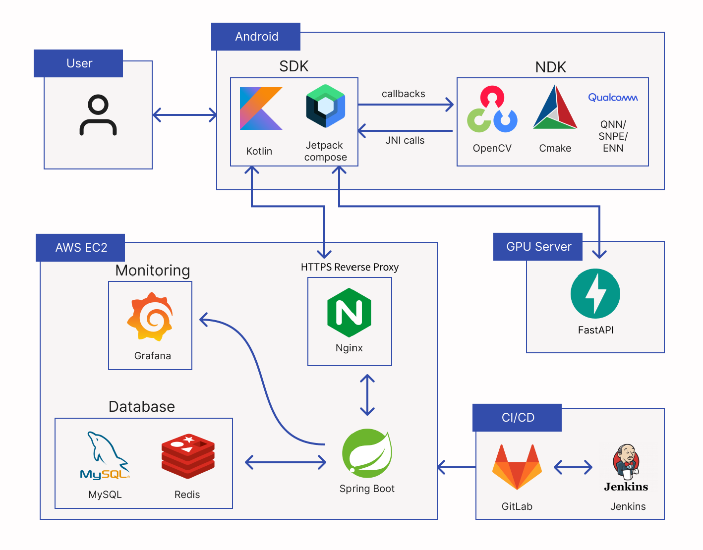

# OnGuard

<div align="center">


**실시간 딥페이크 영상통화 탐지 및 보이스피싱 방어 시스템**

</div>

---

## Background

스마트폰 영상통화가 일상화되면서 **생성형 AI 기반 딥페이크** 기술을 악용한 보이스피싱 범죄가 급증하고 있습니다. 공격자는 지인의 얼굴을 실시간으로 합성하여 영상통화를 시도하며, 피해자 입장에서는 영상을 보고도 가짜임을 인지하기가 사실상 불가능합니다.

| 문제 | OnGuard의 해결 방법 |
|------|---------------------|
| 영상통화 중 딥페이크를 실시간으로 감지할 수 없음 | 온디바이스 AI 모델(ForensicAdapter)로 통화 화면을 실시간 분석, 이상 감지 즉시 경고 오버레이 표시 |
| 딥페이크 감지 시 보호자에게 알릴 수단 없음 | 감지 즉시 등록된 보호자에게 FCM 푸시 알림 + GPS 위치 자동 공유 |
| 통화 상대방의 실제 위치 확인 불가 | 상대방 IP 기반 국가 위치를 지도에 시각화하여 표시 |
| 통화 중 대화 내용 실시간 분석 도구 없음 | 온디바이스 Whisper STT + GPT-4o-mini 위험 키워드 자동 태깅 |
| 피해 발생 후 대응 수단 부재 | 금융 거래 차단 가이드 오버레이, 최근 감지 기록 타임라인 제공 |

---

## Sub-module README

| 모듈 | 링크 |
|------|------|
| Android 앱 (Frontend) | [frontend/shutter-android/README.md](frontend/shutter-android/README.md) |
| 온디바이스 AI 모델 | [frontend/shutter-android/app/src/main/cpp/AI_README.md](frontend/shutter-android/app/src/main/cpp/AI_README.md) |
| 딥페이크 발신자 시뮬레이터 (Demo) | [frontend/shutter-android/demo/README.md](frontend/shutter-android/demo/README.md) |
| 백엔드 서버 (Backend) | [shutter-BE/README.md](shutter-BE/README.md) |
| 포팅 매뉴얼 | [exec/포팅매뉴얼.md](exec/포팅매뉴얼.md) |

---

## 1. Key Features & System Architecture

### System Architecture

<div style="background-color:white; display:inline-block; padding:8px;">

</div>

```
┌─────────────────────────────────────────────────────────────────────┐
│                      OnGuard Android App                             │
│                                                                      │
│   ┌─────────────────────────┐   ┌──────────────────────────────┐   │
│   │     Vision Pipeline      │   │       Audio Pipeline          │   │
│   │  MediaProjection 캡처    │   │  Agora 오디오 스트림 (PCM)    │   │
│   │  OpenCV 얼굴 검출        │   │  Whisper BASE STT (온디바이스)│   │
│   │  ForensicAdapter ONNX    │   │  GPT-4o-mini 위험 태그 분류  │   │
│   │  (INT8 + NNAPI/QNN)      │   │                              │   │
│   └────────────┬────────────┘   └───────────────┬──────────────┘   │
│                └──────────────┬─────────────────┘                   │
│                               ▼                                      │
│             딥페이크 감지 경고 오버레이 표시                            │
│             금융 앱 차단 가이드 + 위험 태그 표시                        │
└───────────────────────────────┬─────────────────────────────────────┘
                                │ REST API + WebSocket + FCM
┌───────────────────────────────▼─────────────────────────────────────┐
│                     Spring Boot Backend (Java 21)                    │
│                                                                      │
│   OAuth2 (Kakao)  │  JWT 인증  │  Agora RTC 토큰  │  FCM 푸시 알림  │
│   실시간 GPS WebSocket (STOMP)  │  AI 텔레메트리 수집                 │
└───────────────────────────────┬─────────────────────────────────────┘
                    ┌───────────┼───────────┐
                    ▼           ▼           ▼
                 MySQL        Redis      Grafana
              (영구 데이터)  (GPS·캐시)  (모니터링)
```

### 주요 기능

| 기능 | 설명 |
|------|------|
| **실시간 딥페이크 감지** | ForensicAdapter ONNX 모델(INT8 양자화 + NNAPI/QNN 가속)로 영상통화 화면을 1fps 분석, 10프레임 평균 확률로 판정 |
| **온디바이스 STT + LLM 위험 분류** | Agora 오디오 스트림을 Whisper BASE로 전사 → GPT-4o-mini로 `#금융거래` `#개인정보요구` `#특정장소유인` `#일상대화` 태그 분류 |
| **경고 오버레이** | 딥페이크 감지 시 상대방 위치 → 보호자 알림 → GPS 공유 → 금융 차단 가이드를 5단계 애니메이션으로 노출 |
| **Agora 영상통화** | 카카오 친구 목록에서 수신자 선택, FCM 기반 수신 전화 알림(잠금화면/백그라운드 포함) |
| **실시간 GPS 추적** | STOMP over WebSocket으로 피보호자 위치를 보호자 화면에 실시간 브로드캐스팅 |
| **보호자 관리** | 카카오 친구 목록에서 보호자/피보호자 관계 등록·삭제 |
| **최근 감지 기록** | 딥페이크 감지 이력 타임라인 (날짜별 세션 카드, 나/보호자 필터) |

### 기술 스택

| 영역 | 기술 |
|------|------|
| **Android** | Kotlin, Jetpack Compose, MVVM + Clean Architecture |
| **온디바이스 AI** | ONNX Runtime, PyTorch Android, Whisper BASE (WhisperKit), OpenCV, Qualcomm QNN, NNAPI |
| **영상통화** | Agora RTC SDK 4.3.0 |
| **인증** | Kakao OAuth2, JWT (자동 갱신) |
| **푸시 알림** | Firebase Cloud Messaging (FCM) |
| **Backend** | Java 21, Spring Boot 3.5.11, Spring Security, Spring WebSocket (STOMP) |
| **Database** | MySQL 8+ (영구 데이터), Redis (GPS·세션 캐시) |
| **인프라** | Docker, Docker Compose, Jenkins CI/CD, Nginx, Grafana |

### Project Structure

```
S14P21A404/
├── frontend/
│   └── shutter-android/                  # Android 앱 (Kotlin + Jetpack Compose)
│       ├── app/
│       │   ├── src/main/
│       │   │   ├── java/com/s14p21a404/shutter/
│       │   │   │   ├── data/             # Repository 구현체, 딥페이크 탐지기, 토큰 관리
│       │   │   │   ├── domain/           # UseCase, Repository 인터페이스, 모델
│       │   │   │   ├── network/          # Retrofit, OkHttp, WebSocket 클라이언트
│       │   │   │   ├── presentation/     # Compose 화면, ViewModel, 오버레이 관리자
│       │   │   │   ├── push/             # FCM 서비스, 통화 이벤트 버스
│       │   │   │   └── di/               # ServiceLocator (수동 DI)
│       │   │   ├── cpp/                  # NDK C++ 추론 코드 (AI_README.md 참고)
│       │   │   ├── jniLibs/              # 프리컴파일 네이티브 라이브러리 (arm64-v8a)
│       │   │   └── assets/              # AI 모델 파일 (face_deepfake_v6.onnx)
│       │   └── build.gradle.kts
│       └── demo/                         # 딥페이크 발신자 시뮬레이터 (→ 5. App Test 참고)
├── shutter-BE/                           # Spring Boot 백엔드
│   ├── src/main/java/com/shutter/api/
│   │   ├── global/                       # JWT, Security, Redis 설정
│   │   ├── user/                         # 로그인, 보호자-피보호자 관계
│   │   ├── rtc/                          # Agora 토큰 발급, 통화 세션 제어
│   │   ├── gps/                          # WebSocket 실시간 위치 브로드캐스팅
│   │   └── notification/                 # FCM 푸시 알림 전송
│   ├── docker-compose.yml
│   ├── Jenkinsfile
│   └── README.md
├── convention/                           # Git·Jira 협업 규칙
└── docs/
    └── images/                           # README 이미지 리소스
```

---

## 2. Setup

### Android 앱

| 항목 | 버전 |
|------|------|
| Android Studio | Ladybug 이상 |
| Kotlin | 2.0+ |
| minSdk / targetSdk | 33 / 36 |
| NDK | 21.4.7075529 |
| JDK | 17 |

`frontend/shutter-android/local.properties`에 아래 키를 설정합니다.

```properties
kakao.native.app.key=YOUR_KAKAO_NATIVE_APP_KEY
server.base.url=https://your-server.com/
agora.app.id=YOUR_AGORA_APP_ID
GMS_API_TOKEN=YOUR_GMS_API_TOKEN
```

`app/google-services.json`을 Firebase 콘솔에서 다운로드하여 `app/` 디렉터리에 배치합니다.

딥페이크 감지 모델(`face_deepfake_v6.onnx`)을 [Google Drive](https://drive.google.com/drive/folders/1GjIa639kj6JfeqcrfLXEPH8L_xLmlJyM)에서 다운로드하여 `app/src/main/assets/`에 배치합니다.

자세한 내용은 [Frontend README](frontend/shutter-android/README.md)를 참고하세요.

---

### 백엔드 서버

| 항목 | 버전 |
|------|------|
| Java | 21 LTS |
| Spring Boot | 3.5.11 |
| MySQL | 8+ |
| Redis | 최신 안정 버전 |

`shutter-BE/.env` 파일을 생성하여 환경 변수를 설정합니다.

```env
DB_HOST=localhost
DB_PORT=3307
DB_NAME=shutter
DB_USERNAME=your_db_username
DB_PASSWORD=your_db_password
REDIS_HOST=localhost
REDIS_PORT=6379
KAKAO_REST_API_KEY=your_kakao_rest_api_key
JWT_SECRET=your_jwt_secret_key_at_least_32_chars
```

자세한 내용은 [Backend README](shutter-BE/README.md)를 참고하세요.

---

## 3. Usage

### Android 앱 빌드 및 실행

```bash
cd frontend/shutter-android

# CLI 빌드
./gradlew assembleDebug

# 또는 Android Studio에서 프로젝트 열고 Run
```

### 백엔드 서버 실행

```bash
cd shutter-BE

# 로컬 인프라(MySQL, Redis) 컨테이너 구동
docker-compose -f docker-compose.local.yml up -d

# Spring Boot 실행
./gradlew bootRun
```

API 명세: `http://localhost:8080/swagger-ui.html`

---

## 4. App Test

OnGuard의 딥페이크 감지 기능을 실제로 검증하려면 **딥페이크 영상을 송출하는 공격자 환경**이 필요합니다. `demo/` 폴더에는 웹캠 영상에 실시간 페이스스왑을 적용하여 Agora 채널로 송출하는 시뮬레이터가 포함되어 있습니다. 이를 통해 OnGuard 앱이 실제 딥페이크 통화를 수신했을 때 감지 및 경고 오버레이가 정상 동작하는지 end-to-end로 시연할 수 있습니다.

자세한 내용은 [Demo README](frontend/shutter-android/demo/README.md)를 참고하세요.

### Setup

| 항목 | 권장 사양 |
|------|-----------|
| Python | 3.10 ~ 3.12 |
| GPU | NVIDIA (CUDA 12.x, cuDNN 9.x) 권장 |

```bash
cd frontend/shutter-android/demo

python -m venv venv
# Windows
venv\Scripts\activate
# macOS / Linux
source venv/bin/activate

pip install fastapi "uvicorn[standard]" opencv-python insightface pillow "numpy<2"
# GPU 사용 시
pip install onnxruntime-gpu
```

`inswapper_128.onnx` 모델을 [HuggingFace](https://huggingface.co/deepinsight/inswapper/resolve/main/inswapper_128.onnx)에서 다운로드하여 `demo/` 디렉터리에 배치합니다.

`deepfake-caller.html` 상단의 상수를 환경에 맞게 수정합니다.

```javascript
const APP_ID = 'YOUR_AGORA_APP_ID';
const WS_URL = 'ws://localhost:8765';
```

### Usage

```bash
# 1. 페이스스왑 서버 실행
# Windows (GPU 사용 시 cuDNN 경로 추가)
set PATH=venv\Lib\site-packages\nvidia\cudnn\bin;%PATH%
python server.py

# 2. 브라우저 클라이언트 서빙
python -m http.server 8080
# → http://localhost:8080/deepfake-caller.html
```

**시연 순서**

1. 브라우저에서 카카오 로그인
2. 소스 얼굴 이미지 업로드 → 페이스스왑 ON
3. 피해자(OnGuard 앱 설치 기기) 카카오 ID 입력 → 통화 시작
4. OnGuard 앱에서 통화 수락 → 딥페이크 감지 경고 오버레이 확인

---

## 5. Contributors

| 이름 | 역할 | 담당 |
|------|------|------|
| **윤상현** | Backend / Infra | 카카오 OAuth2·JWT 인증 체계, 보호자-피보호자 DB 설계, Agora RTC 세션 제어, WebSocket GPS 브로드캐스팅, FCM 알림, Redis 분산 락, Docker·Jenkins CI/CD |
| **박수민** | Frontend / Backend | 전체 화면 구현, GPS 위치 추적, 카카오톡 연동, 보호자 등록·관리, 최근 기록 타임라인, 서버 연동, Demo 발신자 시뮬레이터, Grafana 텔레메트리 파이프라인 |
| **이세원** | Frontend | UI/UX 디자인, 딥페이크 감지 경고 오버레이, 영상통화 탐지 연동, 금융 앱 차단 오버레이 |
| **정다진** | Frontend / AI | Agora 영상통화(요청·수락·거절), NDK, 온디바이스 딥페이크 탐지, 영상 전처리, 탐지 결과 집계 |
| **성주희** | Frontend / AI | 딥페이크 경고창·탐지 영역 표시, NDK, 온디바이스 STT/LLM 대화 분석, OpenCV 얼굴 탐지, HTP→GPU→CPU 폴백, QNN/NNAPI 최적화, INT8 양자화, 탐지 결과 서버 전송 |
| **장유진** | AI | NDK, 온디바이스 딥페이크 탐지, 모델 성능 향상, CAM 기반 ROI 추출, PyTorch→ONNX 변환 |
