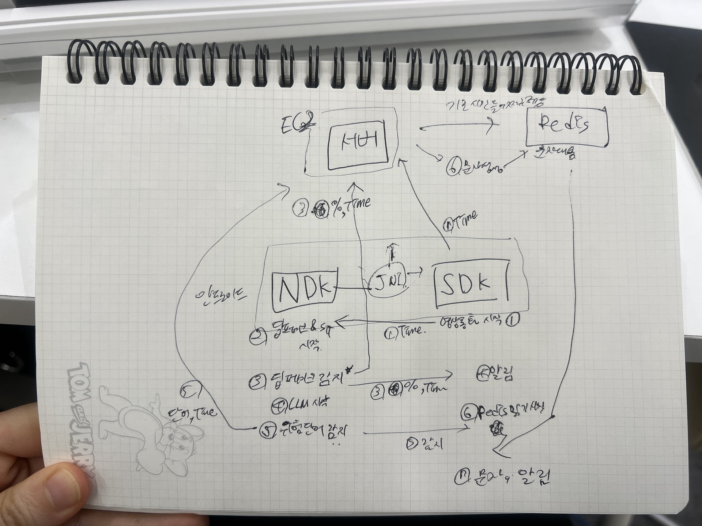

# 0226 학습 기록

## 1. AI 스켈레톤 코드 학습

### 1-1. 학습 개요
목표: Knowledge Distillation과 LoRA Fine-Tuning을 결합하여 Text-to-SQL Task에 특화된 경량화 모델 학습.

전략: Teacher Model이 생성한 Pseudo Label을 활용하여 데이터셋을 확장하고, LoRA를 통해 제한된 GPU 자원으로 Student Model을 효율적으로 고도화함.

### 1-2. 핵심 개념 정리
Knowledge Distillation (지식 증류): 거대 모델(Teacher)의 복잡한 추론 능력을 소형 모델(Student)에 전이하는 기법. 본 실습에서는 Teacher가 생성한 SQL 결과를 정답 데이터로 사용하는 Pseudo Labeling 방식을 적용함.

LoRA (Low-Rank Adaptation): 모델의 전체 가중치를 고정하고 일부 저차원 행렬(Rank)만 학습하는 PEFT 기법. Full Fine-Tuning 대비 파라미터 수를 획기적으로 줄여 GPU 메모리 효율성을 극대화함.

### 1-3. 실습 내용 및 트러블슈팅
EDA 및 전처리: SQL 쿼리의 난이도 분포와 토큰 길이를 분석하여 학습 데이터의 균형을 점검함. map 함수 적용 시 **함수 선언 순서(NameError 해결)**와 **프롬프트 마스킹(-100 적용)**을 통해 모델이 SQL 정답 부분에만 집중하도록 설계함.

환경 구축 및 라이브러리 최적화 (핵심):

의존성 해결: trl과 transformers 간의 버전 불일치로 발생한 enable_tf32 에러를 강제 재설치(--force-reinstall) 및 커널 재시작을 통해 해결함.

인증 관리: .env 파일을 활용하여 Upstage API Key를 안전하게 로드하고, 모델 명칭(solar-pro)을 동기화함.

플랫폼 제약 확인: vLLM의 윈도우 환경 제약(vllm._C 부재)을 확인하고, 실제 서빙 환경에서는 WSL2 또는 Docker 기반의 리눅스 환경이 필수적임을 학습함.

### 1-4. 모델 평가
Execution Accuracy: 단순 텍스트 일치 여부가 아닌, 생성된 SQL을 실제 DB에서 실행한 결과를 바탕으로 정확도를 측정함.

결과 분석: predict.txt 파일을 검토하여 모델이 데이터베이스 구조(Schema)를 얼마나 정확히 이해하고 쿼리를 생성했는지 확인 완료함.

### 1-5. 학습 정리
데이터 전략: 양질의 Pseudo Label을 생성하는 것이 Student Model의 성능 상한선(Upper Bound)을 결정함을 인지함.

엔지니어링 역량: AI 모델 학습 시 라이브러리 버전 호환성(Dependency) 및 OS 환경별 라이브러리 빌드 차이를 관리하는 능력이 실무에서 매우 중요함을 체득함.

효율적 튜닝: LoRA를 활용하여 성능 하락을 최소화하면서도 학습 속도와 자원 효율성을 동시에 잡는 전략적 파인튜닝 프로세스를 확립함.

### 1-6. 핵심 트러블슈팅
학습 과정 중 발생한 주요 에러와 해결 방법은 다음과 같습니다.

❌ Issue 1. 환경 불일치로 인한 모듈 로드 실패
에러 메시지: ModuleNotFoundError: No module named 'dotenv'

원인: 터미널 환경(base)에서 패키지를 설치했으나, 주피터 노트북의 실행 커널이 해당 가상환경과 연결되지 않음.

해결: 노트북 셀 내에서 직접 !pip install python-dotenv를 실행하여 현재 활성화된 커널에 패키지를 강제 설치함.

❌ Issue 2. API 인증 및 모델 명칭 오류
에러 메시지: AuthenticationError: Error code: 401 - invalid_api_key

원인: .env 파일의 API Key 로드 실패 및 존재하지 않는 모델명(solar-pro3) 호출.

해결:

Upstage 콘솔에서 유효한 API Key를 재발급받아 .env 파일에 저장.

모델명을 실제 제공되는 이름인 solar-pro로 수정.

보안 주의: API Key는 외부 노출 시 즉시 폐기해야 함을 인지함.

❌ Issue 3. 라이브러리 간 버전 호환성 충돌
에러 메시지: RuntimeError: Failed to import trl... cannot import name 'enable_tf32' from 'transformers.utils.import_utils'

원인: 최신 버전의 trl이 구버전 transformers 라이브러리의 함수를 참조하려다 발생한 의존성 이슈.

해결: pip install -U trl transformers 명령어로 두 패키지를 최신 버전으로 동시에 업데이트한 후 커널 재시작을 통해 메모리에 반영함.

❌ Issue 4. 운영체제 제약 (vLLM 관련)
에러 메시지: ModuleNotFoundError: No module named 'vllm._C'

원인: vLLM은 리눅스 기반 고속 추론 라이브러리로, 윈도우 환경에서는 핵심 바이너리(_C)를 로드할 수 없음.

학습 내용: 윈도우에서 고성능 AI 모델 서빙을 위해서는 WSL2(Linux) 혹은 Docker 환경이 필수적임을 이해함.

### 1-7. 최종 평가 및 소감
평가 지표: 실제 DB에서 쿼리를 실행해 보는 Execution Accuracy를 기준으로 predict.txt 결과를 검토했습니다.

소감: 모델 성능만큼이나 중요한 것은 안정적인 개발 환경 구축이라는 점을 깨달았습니다. 라이브러리 버전 관리와 환경 격리에 대한 깊은 이해를 얻은 시간이었습니다.

## 2. 오늘 한 일
### 2-1. 기획 산출물 역할분담
### 2-2. 요구사항 명세서 템플릿
### 2-3. MVP 수정 및 Adavanced 선정

#### MVP (과거)

① 영상통화 중, 실시간 지인 사칭·딥페이크 위험 판별 (On-device 추론)
② 영상통화 중, 딥페이크일 경우 즉시 딥페이크 감지 알림
        ex_딥페이크 피싱 감지
③ 영상통화 중, 딥페이크일 경우 대화 내용 분석 (On-device 추론)
④ 영상통화 중, 딥페이크 확률 및 대화 분석 기반 위험도 단계별 즉시 알림
        ex_상대에게 계좌번호 및 집주소를 발설하였습니다. 금융 사기가 의심되어 전화를 종료하세요.
⑤ 영상통화 중, 딥페이크일 경우, 금융 앱 실행 차단(보호 모드)
⑥ 영상통화 중, 딥페이크일 경우, 보호자 긴급 알림 시스템
        ex_OOO님이 00시 00분에 xxx-xxxx-xxx 번호로 계좌번호 및 집주소를 발설하였습니다. 피싱이 의심되므로 조치가 필요합니다.

#### MVP (현재)

① 영상통화 중, 실시간 지인 사칭·딥페이크/딥보이스 위험 판별 (On-device 추론)
② ① 영상통화 중, 딥페이크/딥보이스일 경우 즉시 딥페이크/딥보이스 감지 알림
        ex_ AI 위조 감지 전화를 종료해주세요
② ②영상통화 중, 딥페이크일 경우 딥페이크 의심 영역 확대하여 팝업
② ③ 영상통화 중, 딥페이크/딥보이스일 경우, 소리 알림

        ex_AI 위조 감지 전화를 종료해주세요
② ④ 영상통화 중, 딥페이크/딥보이스일 경우, 통화 버튼제외 영상통화 화면 블라인드 처리
③ 영상통화 중, 딥페이크/딥보이스일 경우, 금융 앱 실행 차단
④ 영상통화 중, 딥페이크/딥보이스일 경우, 보호자 긴급 알림 시스템
        ex_OOO님 피싱이 의심되므로 조치가 필요합니다.

### 2-4. 대략적인 전체 아키텍처 고안

### 2-5. 팀명&프로젝트명 확정
팀명: 펀치더몽키
프로젝트명 : 셔터 (Shutter)
### 2-6. 1차 전문가 리뷰 서류작성완료