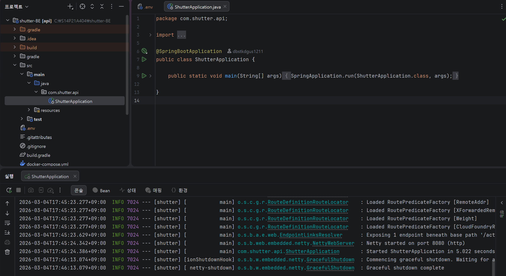

# 0304 학습기록

## 1. Spring Boot 기본 개념 학습

Spring Boot는 Java 기반의 웹 애플리케이션을 빠르게 개발할 수 있도록 지원하는 프레임워크이다.  
기존 Spring Framework는 설정이 복잡하고 초기 환경 구성이 어려웠지만, Spring Boot는 자동 설정(Auto Configuration)과 내장 서버를 제공하여 별도의 설정 없이도 빠르게 서버를 실행할 수 있다.

Spring Boot의 주요 특징은 다음과 같다.

- Auto Configuration  
  프로젝트에 추가된 라이브러리를 기반으로 필요한 설정을 자동으로 구성한다.

- 내장 서버 제공  
  Tomcat과 같은 웹 서버가 내장되어 있어 별도의 서버 설치 없이 애플리케이션 실행만으로 웹 서버가 구동된다.

- 의존성 관리  
  Gradle 또는 Maven을 통해 라이브러리 의존성을 쉽게 관리할 수 있다.

- Starter Dependency 제공  
  `spring-boot-starter-web` 등의 starter 패키지를 통해 여러 라이브러리를 한 번에 설정할 수 있다.

---

## 2. Spring Boot 서버 동작 구조 이해

Spring Boot 애플리케이션은 일반적으로 다음과 같은 구조로 구성된다.

- Controller
  클라이언트로부터 들어오는 HTTP 요청을 처리하는 계층이다.  
  API 엔드포인트를 정의하고 요청 데이터를 받아 Service 계층으로 전달한다.

- Service
  비즈니스 로직을 처리하는 계층이다.  
  Controller에서 전달받은 데이터를 처리하고 필요한 경우 Repository 계층을 통해 데이터베이스와 통신한다.

- Repository
  데이터베이스 접근을 담당하는 계층이다.  
  JPA 등을 사용하여 데이터 조회 및 저장을 수행한다.

- Entity (Domain)
  데이터베이스 테이블과 매핑되는 객체이다.

이러한 계층 구조를 통해 역할을 분리하여 유지보수와 확장성을 높일 수 있다.

---

## 3. REST API 동작 원리 학습

Spring Boot에서는 주로 REST API 형태로 서버를 구성한다.  
클라이언트(모바일 앱 또는 웹)가 HTTP 요청을 보내면 서버는 해당 요청을 처리하고 JSON 형식의 응답을 반환한다.

REST API 기본 흐름

클라이언트 요청  
→ Controller에서 요청 수신  
→ Service에서 로직 처리  
→ Repository를 통해 DB 접근  
→ 처리 결과를 JSON 형태로 응답

이를 통해 모바일 앱과 서버 간 데이터 통신이 이루어진다.

---

## 4. 서버와 데이터베이스 연동 개념 이해

웹 서버는 애플리케이션 실행뿐 아니라 데이터 저장 및 관리 기능을 수행한다.  
Spring Boot에서는 보통 MySQL과 같은 관계형 데이터베이스와 연동하여 데이터를 저장한다.

데이터 흐름 예시

클라이언트 요청  
→ 서버에서 데이터 처리  
→ 데이터베이스 저장  
→ 저장 결과 반환

이러한 구조를 통해 서버는 로그 데이터, 사용자 정보, 서비스 운영 데이터를 관리할 수 있다.

---

## 5. AI 서비스에서 서버의 역할 이해

On-device AI 구조에서는 AI 모델이 모바일 기기에서 직접 실행된다.  
따라서 서버는 AI 추론을 수행하지 않고 다음과 같은 역할을 담당한다.

- AI 모델 실행 결과 수집
- 서비스 운영 로그 저장
- 모델 상태 모니터링
- 시스템 운영 데이터 관리

이러한 구조는 개인정보 보호 측면에서 유리하며 서버의 연산 부담을 줄일 수 있다는 장점이 있다.

---

## 6. 개발 시작

IntelliJ를 사용하여 Spring Boot 프로젝트를 생성하였다.

또한 인프라 팀원이 만들어준 구조를 사용해 docker와 연결해 개발의 초석을 다졌다. 

---

## 7. 정리

이번 학습을 통해 Spring Boot의 기본 구조와 웹 서버의 동작 원리를 이론적으로 이해하였다.  
또한 서버가 클라이언트와 데이터베이스 사이에서 어떤 역할을 수행하는지 확인하였으며, On-device AI 서비스에서 서버가 Telemetry 데이터를 수집하고 모니터링 역할을 수행하는 구조를 이해하였다.